<p align="center">
  <picture>
    <source media="(prefers-color-scheme: dark)" srcset="https://raw.githubusercontent.com/nushell/reedline/main/assets/wordmark-dark.svg">
    
  </picture>
</p>

# A feature-rich line editor - powering Nushell

[](https://crates.io/crates/reedline)
[](https://docs.rs/reedline/)


[](https://discord.gg/NtAbbGn)

Reedline is a line editor in the tradition of bash's `readline` and zsh's `zle`, built for what people expect from a modern shell: syntax highlighting, completions, interactive menus, history hints, multiline editing and more.
It is currently primarily developed as the interactive editor for [nushell](https://github.com/nushell/nushell), striving to provide a pleasant interactive experience.

## Community and roadmap

Talk to us in the `#reedline` channel of the [Nushell Discord](https://discord.gg/NtAbbGn), ideally before you start a larger change.

Roadmap:

- [Prompt, history, hints and the API](https://github.com/nushell/reedline/issues/1284)
- [Edit modes: emacs, vi and helix](https://github.com/nushell/reedline/issues/1221)
- [Completion menu: actions, insertion and display](https://github.com/nushell/reedline/issues/1283)

## Features

- `EditMode`: Emacs, Vi and Helix with configurable keybindings, switchable at runtime.
- `Validator`: multiline editing.
- `Highlighter`: syntax highlighting.
- `Completer` and `Menu`: completions in a columnar, list, IDE-style or description menu.
- `History`: plain file or SQLite, shared between sessions, with interactive search.
- `Hinter`: fish-style autosuggestions.
- `Prompt`: custom and transient prompts, semantic prompt markers (OSC 133).
- `StatusLine`: a live line under the buffer.
- `ExternalPrinter`: output from other threads while the prompt is active.
- Undo and redo, system clipboard, visual selection, abbreviations and auto pairs.
- External editor, bracketed paste, kitty keyboard protocol and mouse click to move the cursor.

## Getting started

```sh
cargo add reedline
```

```rust,no_run
use reedline::{DefaultPrompt, Reedline, Signal};

let mut line_editor = Reedline::create();
let prompt = DefaultPrompt::default();

loop {
    match line_editor.read_line(&prompt) {
        Ok(Signal::Success(buffer)) => println!("We processed: {buffer}"),
        Ok(Signal::CtrlD) | Ok(Signal::CtrlC(_)) => {
            println!("\nAborted!");
            break;
        }
        x => println!("Event: {x:?}"),
    }
}
```

- [`examples/`](./examples): one runnable program per feature. Start with `cargo run --example demo`.
- [docs.rs/reedline](https://docs.rs/reedline): the API documentation.
- [KEYBINDINGS.md](./KEYBINDINGS.md): the default keybindings.

## Crate features

All off by default.

- `system_clipboard`: cut, copy and paste to the system clipboard, beside reedline's own cut buffer.
- `bashisms`: history expansion such as `!!` and `!$`.
- `sqlite`: `SqliteBackedHistory`, with SQLite linked statically.
- `sqlite-dynlib`: the same, linked dynamically. Requires `sqlite >= 3.45.3`.
- `libc`: crossterm uses `libc` instead of `rustix`.

## Contributing

See [CONTRIBUTING.md](./CONTRIBUTING.md).

## Alternatives

- [rustyline](https://crates.io/crates/rustyline)

## License

[MIT](./LICENSE)
