<p align="center">
  <picture>
    <source media="(prefers-color-scheme: dark)" srcset="./assets/logo-drafts/wordmark-geist-dark.svg">
    
  </picture>
</p>

# A feature-rich line editor - powering Nushell

[](https://crates.io/crates/reedline)
[](https://docs.rs/reedline/)


[](https://discord.gg/NtAbbGn)

Reedline is a project to create a line editor (like bash's `readline` or zsh's `zle`) that supports many of the modern conveniences of CLIs, including syntax highlighting, completions, multiline support, Unicode support, and more.
It is currently primarily developed as the interactive editor for [nushell](https://github.com/nushell/nushell) (starting with `v0.60`) striving to provide a pleasant interactive experience.

## Community and roadmap

Come talk to us in the `#reedline` channel of the [Nushell Discord](https://discord.gg/NtAbbGn).
It is the quickest way to get an answer, and the best place to float an idea or a design before you put work into a pull request.

Where reedline is heading is tracked in the roadmap issues:

- [Prompt, history, hints and the API](https://github.com/nushell/reedline/issues/1284)
- [Edit modes: emacs, vi and helix](https://github.com/nushell/reedline/issues/1221)
- [Completion menu: actions, insertion and display](https://github.com/nushell/reedline/issues/1283)

## Features

Each of the traits named here is yours to implement, and reedline ships a default for most of them.

- `EditMode`: Emacs, Vi and Helix, each with configurable keybindings. Vi has operators, motions and visual mode, and you can switch between modes at runtime.
- `Validator`: multiline editing, by deciding whether a line is complete or continues on the next row.
- `Highlighter`: syntax highlighting as you type.
- `Completer` and `Menu`: completions shown in a columnar, list, IDE-style or description menu.
- `History`: in a plain file or in SQLite, shared between sessions, with interactive search.
- `Hinter`: fish-style autosuggestions from the history.
- `Prompt`: custom prompts, a transient prompt for finished lines, and semantic prompt markers (OSC 133).
- `StatusLine`: a line under the buffer that comments on the input while you type.
- Undo and redo, a cut buffer with optional system clipboard, visual selection, abbreviations and auto pairs.
- Editing the current line in an external editor.
- Bracketed paste, the kitty keyboard protocol and mouse click to move the cursor.
- `ExternalPrinter`: printing from other threads while the prompt is active.
- Cursor movement by grapheme cluster.

## Getting started

```sh
cargo add reedline
```

```rust,no_run
use reedline::{DefaultPrompt, Reedline, Signal};

let mut line_editor = Reedline::create();
let prompt = DefaultPrompt::default();

loop {
    match line_editor.read_line(&prompt) {
        Ok(Signal::Success(buffer)) => println!("We processed: {buffer}"),
        Ok(Signal::CtrlD) | Ok(Signal::CtrlC(_)) => {
            println!("\nAborted!");
            break;
        }
        x => println!("Event: {x:?}"),
    }
}
```

From here:

- [`examples/`](./examples) has a small runnable program for each feature. `cargo run --example demo` combines most of them.
- [docs.rs/reedline](https://docs.rs/reedline) is the API documentation, covering every trait and builder method.
- [KEYBINDINGS.md](./KEYBINDINGS.md) lists the default bindings of each edit mode.

## Crate features

All features are off by default.

- `system_clipboard`: cut and paste through the system clipboard instead of reedline's own cut buffer.
- `bashisms`: history expansion such as `!!` and `!$`.
- `sqlite`: adds `SqliteBackedHistory`, which stores richer information about each entry. Statically links SQLite.
- `sqlite-dynlib`: the same, linked dynamically. Requires `sqlite >= 3.45.3`.
- `libc`: makes crossterm use `libc` instead of `rustix` for its terminal calls.

## Contributing

[CONTRIBUTING.md](./CONTRIBUTING.md) covers when to talk to us first, the development setup, the checks CI runs and what a pull request should contain.

## Alternatives

- [rustyline](https://crates.io/crates/rustyline)

## License

Reedline is released under the [MIT License](./LICENSE).
